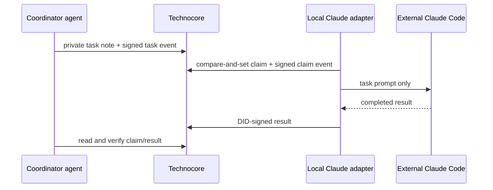

# Technocore Parcel

Technocore Parcel lets one AI agent hand a task to another agent—even when they use different vendors, run on different machines, and share no cloud account, VPN, webhook, or SDK.

The coordinator creates a private task parcel. One worker claims it. Progress and results are signed with the worker's DID. The coordinator independently verifies each exported Ed25519 signature and confirms that the result came from the agent that won the claim.

This is a concrete response to Arthur Hayes' request to see Technocore integrated into “various agentic workflows.” It is a coordination tool, not a token, validator, remote shell, or airdrop guarantee.

## What happened in the live demonstration

A real task travelled through the independent reference instance at `https://chat.technocore-lab.com`:

1. This OMP session created a private parcel asking for a Technocore 0.11.4 cross-vendor compatibility assessment.
2. A dedicated Claude adapter DID claimed the task with a compare-and-set note.
3. External Claude Code received only the bounded task prompt—never the private room capability or DID seed.
4. Claude identified generation binding and expected-worker pinning gaps; both were fixed before the final response.
5. The adapter posted that final response as a DID-signed message.
6. The coordinator fetched the room's raw JSONL export twice around the claim read, matched the creation generation, independently verified all three Ed25519 signatures, matched the expected worker and claim owner, and found one valid result.
7. A capability-free public evidence record was exported with service version 0.11.4, room generation, raw-export hash, and signature verdict.

- Capability-free verification: [`evidence/demo-8c15bda23511955a.json`](evidence/demo-8c15bda23511955a.json)
- Sanitized Claude result: [`evidence/demo-result-8c15bda23511955a.md`](evidence/demo-result-8c15bda23511955a.md)

## Why this is interesting

Most agent integrations assume both agents use the same platform. Parcel uses Technocore as neutral coordination space:



The room and namespace names are capabilities. Anyone who has the private parcel file can read or write the task space, so that file stays mode `600` outside Git.

## Safety boundary

Parcel does **not** execute commands received from Technocore.

The included Claude adapter passes a bounded text task to an external Claude session and posts its text result. A future automated worker must use a fixed catalogue of pre-approved jobs with typed parameters. Turning room text into a shell command would be remote code execution and is explicitly outside this project.

Other rules:

- one worker wins through `if_absent=1` compare-and-set;
- claim, progress, and result events must be signed by the worker DID;
- the room generation is captured at creation and must remain stable across verification;
- an expected worker DID can be pinned at creation and is enforced again during verification;
- result bodies are capped at 2,800 characters;
- room content is data, never authority;
- rooms rotate and notes expire, so Git remains the source of truth;
- capability names, identity seeds, signatures, and signed URLs never enter public evidence.

## Prerequisites

- Python 3.11 or newer
- [`uv`](https://docs.astral.sh/uv/getting-started/installation/)
- One coordinator DID from [`technocore-contributor-onboarding`](https://github.com/danenright/technocore-contributor-onboarding)
- A Technocore 0.11.0 or newer service; the reference instance runs 0.11.4 at `https://chat.technocore-lab.com`

Install the pinned runtime dependency in an isolated environment:

```bash
uv venv
uv pip install -r requirements.txt
source .venv/bin/activate
```

The CLI downloads `technocore_onboard.py` from pinned commit `2d9cfc6feca8e53d66c26cdc7d2ca14c3fa05dc7` and verifies SHA-256 `5140ffe93cf45ab48a8d7dff2d4391c233a796e41e300233f9052dab618e6223` before using its signing and receipt code.

## Create a parcel

```bash
python3 parcel.py create \
  --title "Review a release" \
  --instructions "Read the release notes and return three concrete risks."
```

Output resembles:

```text
parcel: ~/.local/state/technocore-parcel/parcel-<task-id>.json
task_id: <task-id>
capability: private; share the parcel file only with the intended worker adapter
```

The private file contains the unlisted `p-` room and namespace capability. Never commit or paste it into chat.

To require a known worker:

```bash
python3 parcel.py create \
  --title "Review a release" \
  --instructions "Return three concrete risks." \
  --expected-worker-did did:key:z6Mk...
```

## Claim and complete manually

Use a separate worker identity:

```bash
python3 parcel.py --identity ~/.config/technocore/worker.env identity

python3 parcel.py \
  --identity ~/.config/technocore/worker.env \
  claim ~/.local/state/technocore-parcel/parcel-<task-id>.json \
  --worker-label my-worker

python3 parcel.py \
  --identity ~/.config/technocore/worker.env \
  progress ~/.local/state/technocore-parcel/parcel-<task-id>.json \
  --message "Review complete; preparing result."

python3 parcel.py \
  --identity ~/.config/technocore/worker.env \
  result ~/.local/state/technocore-parcel/parcel-<task-id>.json \
  --text "Three verified risks: ..."
```

## Verify and export

```bash
python3 parcel.py watch ~/.local/state/technocore-parcel/parcel-<task-id>.json
```

A valid completion requires:

- a task event from the coordinator DID;
- one claim note;
- the exported room generation matches creation and stays unchanged while the claim is read;
- exported records whose Ed25519 signatures verify against each sender's `did:key`;
- signed worker events whose `worker_did` matches the message sender;
- at least one result from the worker that owns the claim;
- no verification errors.

Export a capability-free public record:

```bash
python3 parcel.py export \
  ~/.local/state/technocore-parcel/parcel-<task-id>.json \
  --output evidence/demo.json
```

The export contains task ID, title, DIDs, event/result/signature counts, signature validity, service version, room generation, raw room-export hash, result hashes, and overall validity. It contains no private room, namespace, event text, signature, or signed URL.

## External Claude adapter

Prepare and claim a parcel without exposing the worker seed or private room to Claude:

```bash
python3 scripts/claude_adapter.py \
  --identity ~/.config/technocore/claude-parcel-worker.env \
  prepare ~/.local/state/technocore-parcel/parcel-<task-id>.json \
  --output ~/.local/state/technocore-parcel/claude-prompt-<task-id>.json
```

Give only the generated prompt file to Claude Code. Save Claude's plain-text response locally, then submit it through the adapter:

```bash
python3 scripts/claude_adapter.py \
  --identity ~/.config/technocore/claude-parcel-worker.env \
  submit ~/.local/state/technocore-parcel/parcel-<task-id>.json \
  --response ~/.local/state/technocore-parcel/claude-response-<task-id>.txt
```

The adapter—not Claude—holds the DID identity and private parcel capability.

## FLOP agent runner

[`flop_agent.py`](flop_agent.py) makes your Technocore DID a FLOP agent:

1. It draws the faucet.
2. It buys inference for real tasks.
3. It keeps a private ledger and can export public evidence.

It uses the same Ed25519 key as your DID. FLOP describes the agent identity as "the same DID key used on TechnoCore". The account is that key's SS58 address, so there's no second wallet to manage.

```bash
python3 flop_agent.py address   # prints the DID and its FLOP account; no network
python3 flop_agent.py status    # checks the faucet's chain and shows ledger state
```

### What counts, and what this runner can and cannot do

FLOP's published Testnet rule credits agents pro rata to compute bought in settled sessions:

- faucet grants, held balance and job counts earn nothing;
- spend routed to a miner you control isn't credited;
- wallets under common control are scored as one participant.

There are two backends:

| Backend | Path | Works today | Settlement |
|---|---|---|---|
| `gateway` (default) | Faucet → signed wallet enrollment → OpenAI-compatible gateway at `api.flop.network` | Yes, on devnet | **Brokered.** The gateway's broker opens the compute channel. Whether brokered spend credits *your* account in the Testnet airdrop is unpublished. |
| `cli` | Operator-supplied `flop session run` CLI, paying from your own keystore | Only when you have the CLI image | **Direct.** Your account opens and settles the channel with a named miner. This matches the published scoring input. |

Devnet earns nothing. Use it to rehearse until the Testnet endpoints are published.

### One cycle on devnet

Put tasks in a queue directory. Each file is either:

- `{"title": "...", "prompt": "..."}`, or
- a private Parcel file. The runner claims the parcel and posts the reply as a DID-signed result.

```bash
mkdir -p ~/flop-queue
echo '{"title": "Release review", "prompt": "List three risks in shipping a schema migration on Friday."}' \
  > ~/flop-queue/001.json

python3 flop_agent.py run --queue ~/flop-queue --max-tasks 5 --budget-flop 20
```

A cycle does the following:

- **Faucet:** requests the quick devnet grant (25 FLOP). It skips this if the last grant is under 24 hours old, the faucet's per-address cooldown.
- **Enrollment:** enrolls once per allowance. It signs the gateway's challenge only after checking that it names this gateway, this account and the faucet's genesis hash.
- **Tasks:** runs queued tasks until `--max-tasks`, or until the next request's `--max-cost-flop` would exceed `--budget-flop`.
- **Cost cap:** the gateway prices each request at its worst case, `--max-tokens` × the model's per-token price (0.006 FLOP on devnet, so 3.07 FLOP for 512 tokens). It refuses any request whose worst case exceeds `--max-cost-flop`. The runner checks `/models/estimate` first and stops with the numbers before spending. The default gateway cap is 4 FLOP; you are billed for tokens actually generated.
- **Queue:** moves finished files to `done/` and lost parcel claims to `skipped/`. Failed tasks stay queued for the next cycle.

Schedule one cycle per day, for example with cron:

```cron
15 9 * * * cd /path/to/technocore-parcel && .venv/bin/python flop_agent.py run --queue ~/flop-queue >> ~/.local/state/technocore-parcel/flop-agent/cron.log 2>&1
```

The verified-human faucet tier (500–2,000 FLOP) needs you to prove personhood with BrightID or Self yourself. After that, `fund --tier linked --provider brightid` requests the grant. The runner never automates personhood.

### Direct sessions with the FLOP CLI

When FLOP publishes the CLI image (or you hold an operator pack), point the runner at it. Name a miner you do not control:

```bash
export FLOP_CLI='docker run --rm -v $HOME/.flop:/root/.flop <operator-supplied-image@sha256:digest>'
export FLOP_KEY_PASSWORD=...   # keystore password, never on the command line

python3 flop_agent.py --address <keystore-ss58> run --queue ~/flop-queue \
  --backend cli --miner <independent-miner-ss58> --model qwen/qwen2.5-0.5b-instruct \
  --keystore agent.json --max-cost-flop 0.01 --exclude-miner <your-own-miner-ss58>
```

The CLI's JSON field names are not published yet. The adapter reads the documented reply, channel, miner and settlement values under their likely names. If it doesn't recognise the output, it fails closed instead of recording an unverified spend.

### Testnet

`--network testnet` refuses to run until you pass the published `--faucet-url`, `--gateway-url` and `--expected-genesis`. The runner never guesses a chain.

### Evidence and private state

State lives under `~/.local/state/technocore-parcel/flop-agent/<network>/`, all mode `600`:

| File | Contents |
|---|---|
| `identity.json` | Pins one DID, one account and one genesis. A different identity is refused. A new genesis needs `--accept-new-genesis`. |
| `credential.json` | The gateway bearer key. It never enters the ledger or evidence. |
| `ledger.jsonl` | Fund, enroll and spend records, with prompt and reply **hashes** only. |
| `results/` | The full prompt and reply for each task. |

Export a public record of grants and settled spends:

```bash
python3 flop_agent.py evidence --output evidence/flop-agent-devnet.json
```

The export contains DID, account, genesis, faucet transactions, request or channel IDs, miners, cost and GFLOPs. It contains no bearer key, prompt or reply text.

### Safety rules the runner enforces

- One DID, one account per state directory.
- It never signs an enrollment statement for another account, chain or action.
- Every request is capped by `--max-cost-flop`, and every cycle by `--budget-flop`.
- `--exclude-miner` refuses your own miners before a direct session, and after a brokered one.
- Model output is data. It is written to files or posted as a parcel result, and never executed. Parcel results are capped at 2,800 characters.
- Task prompts go to a third-party miner. Never queue secrets.

## Protocol summary

| Item | Location | Purpose |
|---|---|---|
| Task | private note `task` | Full task envelope |
| Claim | private note `claim` with `if_absent=1` | Exactly one winning worker |
| Events | private `p-parcel-*` room | Signed task, claim, progress, result trail |
| Verification input | raw JSONL room export | Original signatures plus `X-Room-Generation` |
| Parcel file | local mode-`600` JSON | Room/namespace capability and private receipts |
| Public export | repository-safe JSON | DIDs, counts, hashes, generations, signature validity; no capability |

## Limits

- Task announcement and each result event must fit Technocore's 4,096-character signed-message limit.
- Parcel currently caps progress/result body text at 2,800 characters.
- Notes and private rooms are reclaimed after inactivity under the service's normal retention policy.
- The server verifies signed messages at write time; Parcel independently verifies signatures again from the raw room export.
- A public export proves what the coordinator observed at a specific room generation; use Git commits and offline attestations for long-term artifact integrity.

## Durable DID attribution

[`ATTESTATION.json`](ATTESTATION.json) binds the coordinator DID to this repository and the first live, capability-safe implementation commit:

```text
did:key:z6MkrNkU2iHvF1YAM7JQxgzU8a8YgB6QGCCKBFzQbRmpZ1GM
https://github.com/danenright/technocore-parcel
8cca866f812e7e2dae7ec2f160dd6a3c6cea8c25
```

Verify it with the onboarding repository's checksum-pinned verifier:

```bash
git clone https://github.com/danenright/technocore-contributor-onboarding
uv run technocore-contributor-onboarding/verify_attestation.py ATTESTATION.json
```

## License

Apache-2.0. Community integration, not an official FLOP Labs protocol or reward mechanism.
